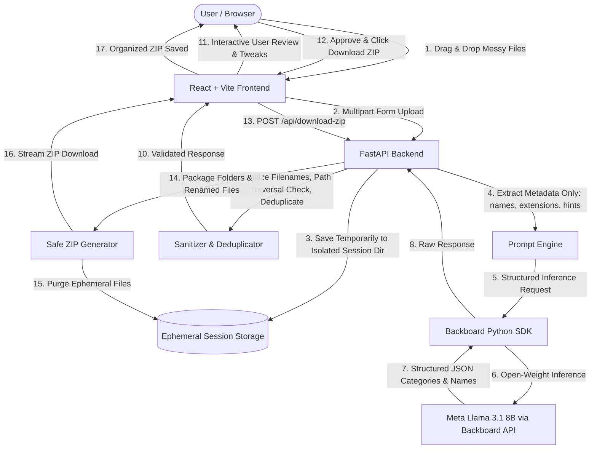

# LazyFlow AI — Let AI Handle the Boring Stuff 📂✨

> **“Upload the mess. Let AI do the rest.”**  
> Built for the **Hacktoberfest DEV Week Challenge: “Slow and Steady”**  
> **Open-Weight AI · Powered by Backboard & Meta Llama 3.1**

[-22c55e?style=for-the-badge&logo=meta)](https://backboard.io)
[](https://docs.backboard.io)
[](https://fastapi.tiangolo.com)
[](https://vitejs.dev)

---

## 📌 Executive Summary & Problem Statement

Everyone suffers from a cluttered **Downloads** folder or **Desktop**. Over weeks of research, invoicing, project delivery, and quick downloads, users end up with hundreds of files named `IMG_20231012_WA0004.jpg`, `Invoice_Oct_final_v2_FINAL.pdf`, `draft_cs50_week3_notes.docx`, or `Screenshot 2024-03-01 at 4.22.19 PM.png`.

Sorting this mess manually is tedious, repetitive, and mentally draining ("the boring stuff").

**LazyFlow AI** is a privacy-first, open-weight AI file organizer. Users drag and drop messy files; LazyFlow invokes an open-weight model (`meta-llama/llama-3.1-8b-instruct`) via the **Backboard SDK** to:
1. **Intelligently classify** files into logical folders (`Documents`, `Finance`, `Images`, `Work`, `Study`, `Code`, or custom user categories).
2. **Suggest clean, human-readable filenames** while strictly preserving original file extensions.
3. **Allow full interactive review** with inline renaming, folder reassignment, and exclusion toggles.
4. **Export a structured ZIP archive** containing the approved hierarchy and renamed files in seconds.

---

## 🧠 Why Open Innovation & Open-Weight AI Matter

Under the Hacktoberfest DEV Week **“Slow and Steady”** ethos, thoughtful, resilient software architecture matters more than hasty hype. LazyFlow AI demonstrates how open innovation empowers everyday tools:

1. **User Privacy & Sovereign Compute:**  
   Unlike invasive systems that scrape entire hard drives or upload proprietary document contents to closed AI monoliths, LazyFlow enforces **Zero File Content Transmission**. Only metadata (filename, extension, size, optional user hints) is sent to the model.
2. **Model Transparency & Control:**  
   Using open-weight models like **Meta Llama 3.1 8B** guarantees that the reasoning, prompt contracts, and token behaviors are open and inspectable. There are no sudden proprietary API changes or arbitrary silent model deprecations.
3. **Economic Efficiency & Cost Control:**  
   A batch of 10–20 file classifications with Llama 3.1 on Backboard consumes a fraction of a cent (~`$0.000003` per classification turn). Users can organize thousands of documents within a standard $5 credit tier without surprise bills.
4. **No Vendor Lock-In:**  
   The Backboard abstraction enables routing to any open-weight weights (Mistral, Qwen, DeepSeek, Llama) without altering backend domain code.

---

## 🌐 What Runs Locally vs. What Requires an Internet Connection

To maintain complete transparency:
- **Local / Self-Hosted:**  
  File saving, safe path sanitization, duplicate name resolution, file exclusion filtering, and ZIP generation run **100% locally** on the server running FastAPI. File contents never leave this local environment.
- **Hosted via Internet (Backboard API):**  
  Classification and smart naming prompts are sent over HTTPS to **Backboard's hosted API endpoint** (`https://app.backboard.io/api`), utilizing the verified open-weight model `meta-llama/llama-3.1-8b-instruct`. This requires an active internet connection.

---

## 🛠️ System Architecture



---

## 🚀 Key Features

| Feature | Description |
| :--- | :--- |
| **Smart Drag-and-Drop** | Upload multiple files simultaneously with size previews, file type detection, and batch protection (max 30 files, up to 50MB each). |
| **Open-Weight AI Categorization** | Files are classified into `Documents`, `Images`, `Work`, `Study`, `Finance`, `Code`, `Other`, or user-defined custom categories. |
| **Smart Descriptive Renaming** | Obscure filenames like `IMG_20231012_WA0004.jpg` become `team-meetup-photo.jpg` based on names and user hints, always preserving true extensions. |
| **Review Before Applying** | Full interactive table to inspect original names, suggested names, destination folders, and AI rationale. Allows inline editing of names and folder reassignment. |
| **Selective Inclusion** | Checkboxes and bulk toggles allow users to easily exclude specific files from the final ZIP archive. |
| **Collision-Free ZIP Generation** | Automatic de-duplication ensures duplicate names in the same folder (e.g. two `invoice.pdf` files) become `invoice.pdf` and `invoice (1).pdf` safely. |
| **Path Traversal Protection** | Complete hardening against directory traversal attacks (`../`, `..\\`), illegal characters, and Windows reserved names (`CON`, `PRN`, `AUX`, `NUL`). |
| **Ephemeral Session Storage** | Temporary uploaded files are strictly wiped after ZIP download or upon session timeout (60 minutes). |

---

## 📂 Project Structure

```
lazyFlow AI/
├── backend/
│   ├── app/
│   │   ├── config.py             # Pydantic Settings & environment variables
│   │   ├── main.py               # FastAPI application, CORS, routers & lifespan
│   │   ├── models/
│   │   │   └── schemas.py        # Pydantic schemas (FileMetadata, OrganizeResponse, etc.)
│   │   ├── services/
│   │   │   ├── ai_organizer.py   # BackboardClient integration with Llama 3.1 8B
│   │   │   └── zip_service.py    # Temporary storage & safe ZIP generation
│   │   └── utils/
│   │       └── sanitizer.py      # Filename & folder sanitization & duplicate resolver
│   ├── tests/
│   │   ├── test_api.py           # FastAPI endpoint tests
│   │   ├── test_organizer.py     # Categorization validation tests
│   │   ├── test_sanitizer.py     # Traversal & illegal char sanitization tests
│   │   └── test_zip_service.py   # ZIP creation & exclusion tests
│   ├── requirements.txt          # Python dependencies
│   ├── .env                      # Local backend secrets (git-ignored)
│   └── .env.example              # Environment variables template
├── frontend/
│   ├── src/
│   │   ├── components/
│   │   │   ├── CategorySummary.tsx # Metrics and category distribution chips
│   │   │   ├── DownloadAction.tsx  # Export action bar with progress spinner
│   │   │   ├── Dropzone.tsx        # Drag & drop upload workspace
│   │   │   ├── Hero.tsx            # Landing problem/solution showcase
│   │   │   ├── ModelBadge.tsx      # Open-Weight AI · Powered by Backboard badge
│   │   │   ├── Navbar.tsx          # Top navigation with status indicators
│   │   │   ├── PrivacyModal.tsx    # Privacy and transparency modal
│   │   │   ├── ReviewTable.tsx     # Review, inline rename, and folder selector
│   │   │   └── StatusBanner.tsx    # Alert banners for errors & configuration
│   │   ├── services/
│   │   │   └── api.ts              # API client and ZIP download helper
│   │   ├── types/
│   │   │   └── index.ts            # TypeScript interfaces
│   │   ├── App.tsx                 # Main application state and workflow
│   │   └── index.css               # Tailwind CSS with forest-green & charcoal theme
│   ├── package.json
│   ├── tailwind.config.js
│   └── vercel.json                 # Vercel deployment configuration
├── sample_data/                    # 9 realistic sample messy test files
├── scripts/
│   ├── generate_sample_data.py     # Script to generate sample files
│   └── verify_backboard.py         # Live Backboard open-weight test script
├── render.yaml                     # Render backend deployment configuration
├── .gitignore                      # Security-hardened gitignore
└── README.md                       # Comprehensive project documentation
```

---

## 🧪 Verified Model Test & AI Benchmark

Before integrating the application, a live test script (`scripts/verify_backboard.py`) was executed against Backboard's hosted API using sample messy files.

### Test Result:
- **Selected Model:** `meta-llama/llama-3.1-8b-instruct`
- **Provider:** `openrouter` (via Backboard SDK)
- **Status:** **PASSED** (100% valid JSON array, zero schema violations, accurate folder assignments, correct extension preservation).
- **Latency:** ~2.1 seconds for 6 complex files.
- **Sample Output:**
  ```json
  [
    {
      "id": "2",
      "original_filename": "Invoice_Oct_final_v2_FINAL.pdf",
      "folder": "Documents",
      "category": "Finance",
      "suggested_filename": "october-cloud-hosting-bill.pdf",
      "reason": "Folder choice: Documents as it's a bill. Category: Finance as it's related to financial transactions."
    },
    {
      "id": "3",
      "original_filename": "draft_cs50_week3_notes.docx",
      "folder": "Documents",
      "category": "Study",
      "suggested_filename": "cs50-week3-lecture-notes.docx",
      "reason": "Folder choice: Documents as it's a document. Category: Study as it's related to academic work."
    }
  ]
  ```

To re-run the verification test anytime:
```bash
python scripts/verify_backboard.py
```

---

## 💻 Local Setup & Development (Windows, Mac, Linux)

### Prerequisites
- Python 3.10+
- Node.js 18+ and npm

### 1. Clone & Configure Environment
```bash
git clone https://github.com/your-username/lazyFlow-AI.git
cd "lazyFlow-AI"
```

Configure backend environment:
```bash
cp .env.example backend/.env
```
Open `backend/.env` and ensure your `BACKBOARD_API_KEY` is set:
```ini
BACKBOARD_API_KEY=your_backboard_api_key_here
BACKBOARD_BASE_URL=https://app.backboard.io/api
BACKBOARD_DEFAULT_PROVIDER=openrouter
BACKBOARD_DEFAULT_MODEL=meta-llama/llama-3.1-8b-instruct
```

### 2. Run Backend
```bash
cd backend
pip install -r requirements.txt
uvicorn app.main:app --reload --port 8000
```
Backend will be live at `http://localhost:8000`.  
Interactive API docs available at `http://localhost:8000/docs`.

### 3. Run Frontend
In a new terminal:
```bash
cd frontend
npm install
npm run dev
```
Frontend will be live at `http://localhost:5173`.

---

## 🧪 Running the Test Suite

LazyFlow includes unit and integration tests covering path sanitization, duplicate resolution, session management, ZIP extraction security, and API endpoints.

To run the backend test suite:
```bash
cd backend
pytest -v
```

Expected result:
```
tests/test_api.py::test_root_endpoint PASSED
tests/test_api.py::test_health_endpoint PASSED
tests/test_api.py::test_model_status_endpoint PASSED
tests/test_api.py::test_organize_empty_files_rejected PASSED
tests/test_api.py::test_organize_batch_size_limit PASSED
tests/test_api.py::test_download_zip_invalid_session PASSED
tests/test_sanitizer.py::test_sanitize_filename_traversal PASSED
tests/test_sanitizer.py::test_sanitize_filename_illegal_chars PASSED
tests/test_sanitizer.py::test_sanitize_filename_reserved_windows_name PASSED
tests/test_sanitizer.py::test_sanitize_filename_preserves_extension PASSED
tests/test_sanitizer.py::test_sanitize_folder_name PASSED
tests/test_sanitizer.py::test_resolve_duplicate_names PASSED
tests/test_zip_service.py::test_zip_generation_and_safe_paths PASSED
tests/test_zip_service.py::test_zip_generation_excludes_skipped PASSED
======================= 14 passed in 1.14s =======================
```

To validate frontend production build:
```bash
cd frontend
npm run build
```

---

## 🚢 Deployment Guide

### Deploy Backend to Render (Free Tier)
1. Push repository to GitHub.
2. Log in to [Render.com](https://render.com) and click **New + > Web Service**.
3. Select your repository.
4. Set:
   - **Root Directory:** `backend`
   - **Environment:** `Python 3`
   - **Build Command:** `pip install -r requirements.txt`
   - **Start Command:** `uvicorn app.main:app --host 0.0.0.0 --port $PORT`
5. Add Environment Variables:
   - `BACKBOARD_API_KEY`: *(your Backboard API key)*
   - `BACKBOARD_BASE_URL`: `https://app.backboard.io/api`
   - `BACKBOARD_DEFAULT_PROVIDER`: `openrouter`
   - `BACKBOARD_DEFAULT_MODEL`: `meta-llama/llama-3.1-8b-instruct`
   - `CORS_ORIGINS`: `*`
6. Click **Deploy**. Note your service URL (e.g., `https://lazyflow-api.onrender.com`).

### Deploy Frontend to Vercel (Free Tier)
1. Log in to [Vercel.com](https://vercel.com) and click **Add New > Project**.
2. Select your repository.
3. Configure project settings:
   - **Framework Preset:** `Vite`
   - **Root Directory:** `frontend`
4. Add Environment Variable:
   - `VITE_API_URL`: `https://lazyflow-api.onrender.com` *(your Render backend URL)*
5. Click **Deploy**.

---

## ⚠️ Limitations & Future Enhancements

- **Batch Size Limit:** The application is capped at 30 files per request and 50MB per file to prevent browser memory exhaustion and maintain fast response times.
- **Deep Content Analysis:** Content analysis is disabled by default for privacy reasons. Future versions can offer an explicit opt-in toggle to OCR or summarize document bodies for files with completely non-descriptive names (`001.bin`).
- **Direct Cloud Sync:** Current output is packaged as a ZIP archive. Future integrations could export directly to Google Drive, Dropbox, or OneDrive.

---

## 📜 License & Acknowledgments

- Built with ❤️ for the **Hacktoberfest DEV Week Challenge: “Slow and Steady”**.
- AI Powered by **[Backboard.io](https://backboard.io)** and **Meta Llama 3.1**.
- Open source under the [MIT License](LICENSE).
